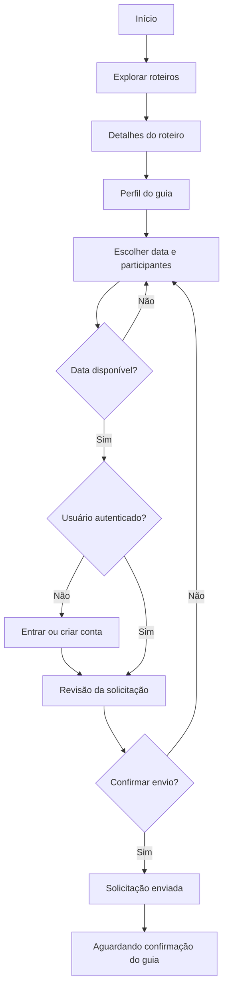

# GuiaSR — Especificação do protótipo a partir do vídeo

**Fonte primária:** `GuiaSr.mp4`, enviado em 16/11/2026. Vídeo de 3min27s, 1918 × 958px, aproximadamente 30 fps.  
**Projeto:** GuiaSR / São Roque Rotas — protótipo acadêmico navegável.  
**Escopo comprovado no vídeo:** 8 telas em **baixa fidelidade**, 8 telas em **alta fidelidade** e uma representação do **fluxo principal**. 

> Esta especificação registra exclusivamente o que é visível no vídeo, distinguindo o que seria uma implementação nova. As imagens e perfis apresentados no protótipo são demonstrativos; não são evidência de pesquisas reais nem de uma plataforma de reservas em funcionamento.

## 1. Inventário das telas, em ordem

| # | Nome | Conteúdo visível | Interação / destino | Captura |
|---|---|---|---|---|
| 01 | Início | Cabeçalho com logo GuiaSR, menu Início / Explorar roteiros / Guias / Entrar; hero com paisagem, busca, roteiros em destaque, categorias Gastronomia/Natureza/Cultura/Aventura | Busca, explorar roteiros, categorias e cards levam à exploração/detalhes | `alta_fidelidade/01_inicio.jpg` |
| 02 | Explorar | Título “Explore São Roque”, busca, filtros de categoria/duração/experiência, limpar, ordenação, contador e cards | Buscar; filtrar; ordenar; abrir detalhes | `alta_fidelidade/02_explorar.jpg` |
| 03 | Roteiro | Banner, nome “Sabores da Rota do Vinho”, duração, descrição, características, destaques, mapa ilustrativo e card do guia | Voltar aos roteiros; conhecer o guia | `alta_fidelidade/03_roteiro.jpg`; `roteiro_detalhes_mapa.jpg` |
| 04 | Guia | Perfil demonstrativo “Carlos Mendes”, imagem, especialidades, idiomas, preço ilustrativo R$ 180/grupo, informações profissionais e experiências oferecidas | Ver disponibilidade; voltar ao roteiro | `alta_fidelidade/04_guia.jpg` |
| 05 | Data | Calendário, disponibilidade ilustrativa, resumo do roteiro/guia/data, seletor de participantes e continuar | Alterar mês/data; incrementar/decrementar participantes; continuar | `alta_fidelidade/05_data.jpg` |
| 06 | Acesso | Layout dividido, imagem da natureza, abas Entrar/Criar conta, campos de e-mail e senha, botão continuar | Entrar e continuar, registro alternativo | `alta_fidelidade/06_acesso.jpg` |
| 07 | Revisão | Card com roteiro, guia, data, participantes, solicitante, preço demonstrativo e aviso “Solicitação sujeita à confirmação” | Voltar e editar; enviar solicitação | `alta_fidelidade/07_revisao.jpg` |
| 08 | Enviada | Ícone de sucesso, mensagem “Sua solicitação foi enviada!”, selo “Aguardando confirmação”, resumo e próximos passos | Voltar ao início; explorar outros roteiros | `alta_fidelidade/08_enviada.jpg` |

### Exemplos usados nas telas

- **Roteiros mostrados:** “Sabores da Rota do Vinho” (Gastronomia, 5 horas), “Caminhos da Mata” (Natureza, 3 horas), “Memórias de São Roque” (Cultura, 2h30).
- **Guia exibido:** “Carlos Mendes”, perfil criado para o protótipo acadêmico — não apresentar como profissional real credenciado. A própria tela diz que credenciais não foram verificadas.
- **Preço mostrado:** R$ 180,00 (valor demonstrativo por grupo).
- **Data em exemplo:** outubro de 2025 (dado fictício/antigo da demonstração). Para o site real, calendário deve usar datas atuais e disponibilidade cadastrada.
- **Contador da lista:** em uma tela aparecem “12 experiências encontradas”, mas apenas três cards estão visíveis; a futura implementação precisa tornar contador e listagem coerentes.

## 2. Fluxo de navegação documentado



**Importante:** o envio de uma solicitação não equivale à confirmação da reserva nem a um pagamento. O protótipo afirma expressamente que nenhuma reserva real é criada. A figura original está em `fluxo_principal.jpg`.

## 3. Comportamentos para reproduzir no front-end

### Navegação
- Menu global Início / Explorar roteiros / Guias / Entrar.
- Links de retorno à etapa anterior sem perder seleção do roteiro/data/participantes.
- Elementos da apresentação acadêmica (abas “01 Baixa fidelidade”, “02 Alta fidelidade”, “03 Fluxo” e contador 1/8) são **invólucro do protótipo**, não necessariamente parte do site final destinado a turistas.

### Catálogo
- Barra de busca textual.
- Filtro de categoria: Todos, Gastronomia, Natureza, Cultura e Aventura.
- Filtros adicionais de duração e tipo de experiência; opção limpar.
- Ordenação (por exemplo “Mais relevantes”, “Menor duração”).
- Cards com foto, categoria, duração, nome, descrição e link Ver detalhes.
- Estados a implementar: lista normal, lista vazia, carregamento e erro.

### Guia e solicitação
- Perfil com idiomas, especialidades, experiências e preço.
- Sinalização honesta de credenciais: **não inventar selo de verificado** sem validação real.
- Calendário visual de disponível, indisponível e selecionado.
- Seletor com limites válidos de participantes; botão continuar só se os dados forem válidos.
- Login/cadastro com validação (na demonstração a autenticação é simulada e os dados não vão a servidor).
- Revisão com edição antes do envio; confirmação com o estado `AGUARDANDO_CONFIRMACAO_GUIA`.

## 4. Direção visual observada (aproximada)

- Visual editorial e minimalista; planos de fundo branco/off-white.
- Cor principal verde-escuro, com verde-musgo suave, detalhes dourado/ocre.
- Fotografias amplas de vinhedos, bosques e turismo rural.
- Muito espaço em branco; tipografia sans-serif de títulos grandes e leves.
- Cards brancos com bordas discretas, cantos arredondados e sombras suaves.
- Botões de ação verdes com texto branco; chips de categoria e indicadores de navegação.
- Layout desktop demonstrado (~1918 × 958px). **Responsividade para celular não foi demonstrada** no vídeo e terá de ser criada e testada.

## 5. O que NÃO está evidenciado no vídeo

Estes recursos apareceram em discussões de escopo do GuiaSR, mas **não foram mostrados nesta gravação**: dashboard de turista, painel de guia, aprovação de guia por administrador, área de empresas/CNPJ, autenticação e reservas reais, checkout, assinatura Premium, cadastro de roteiros, integração com mapa real, funcionalidades mobile, avaliações e notificações. Não registrar como telas concluídas neste pacote.

## 6. Stack sugerida para recriação, sem bloquear a entrega acadêmica

**Primeiro:** React + TypeScript + Vite + React Router + CSS/Tailwind; dados simulados, 8 telas visíveis e fluxo funcional local. Isso permite reconstruir o design sem depender de APIs.  
**Posteriormente:** Spring Boot (Java 17+, Spring Data JPA/Hibernate), PostgreSQL no Docker; APIs de usuários, guias, roteiros, agenda e solicitações. Essa é uma proposta técnica de implementação, não uma tecnologia identificada no vídeo.

### Rotas sugeridas para a reconstrução

```text
/                           -> Início
/roteiros                    -> Explorar
/roteiros/:slug              -> Detalhes do roteiro
/guias/:id                   -> Perfil do guia
/solicitacao/data            -> Calendário e participantes
/acesso                      -> Login / Cadastro
/solicitacao/revisao         -> Revisar
/solicitacao/enviada         -> Confirmação demonstrativa
```

### Componentes sugeridos

`Header`, `Footer`, `SearchBar`, `CategoryFilter`, `DurationFilter`, `ExperienceFilter`, `RouteCard`, `GuideCard`, `Calendar`, `ParticipantStepper`, `BookingSummary`, `AuthForm`, `StatusBadge`, `BackLink`, `EmptyState`, `LoadingSkeleton`.

### Critérios de aceite do MVP visual

- [ ] As 8 telas foram reproduzidas com estrutura e identidade visual próximas às capturas.
- [ ] Links de navegação anterior/próxima e do menu funcionam.
- [ ] Busca, filtros e ordenação mostram resultados coerentes, inclusive lista vazia.
- [ ] Seleção da data e participantes sobrevive à navegação/retorno.
- [ ] Cadastro/login são claramente simulados, se não existir servidor.
- [ ] Enviar solicitação mostra somente o estado pendente de confirmação, sem alegar reserva/pagamento real.
- [ ] Mobile e acessibilidade recebem uma rodada de testes.
- [ ] Imagens usadas têm licença/atribuição apropriadas; dados de pessoas e credenciais demonstrativas permanecem explicitamente fictícios.

## 7. Aplicação acadêmica

**Navegação e Interação:** imagens em `baixa_fidelidade/`, `alta_fidelidade/` e `fluxo_principal.jpg` evidenciam o material de wireframe, protótipo e fluxo principal. O material visual **não prova**, sozinho, que benchmark, personas, card sorting ou validações com usuários tenham sido realizados.  
**Prototipagem e Testes:** as telas permitem planejar tarefas de avaliação (encontrar um roteiro, filtrar, selecionar data, revisar pedido). Os Forms são pesquisa de percepção e necessidades, **não teste de execução de tarefas**. Não usar respostas fictícias como entrevistas ou testes reais.

## 8. Organização de execução sugerida

- **Segunda (16/11), após 19h20:** publicar Forms de viajantes e guias e iniciar a coleta. Se não couberem ambos, concluir primeiro o de viajantes e terminar o de guias na manhã seguinte.
- **Terça (17/11):** consolidar briefing, levantamento de requisitos, público-alvo, jornada, arquitetura, sitemap e inventário. Preparar esqueleto dos dois DOCX.
- **Quarta (18/11):** incorporar capturas de baixa/alta fidelidade, fluxo e detalhamento de navegação; completar lacunas dos capítulos documentais. Começar reconstrução front-end somente se o documento estiver seguro.
- **Quinta (19/11):** revisar ABNT, referências, links, anexos e evidências reais de Forms que já tiverem chegado; entregar versão documental sólida, identificando pendências de testes que exijam participantes.

**Dependência crítica:** divulgar os dois Forms o quanto antes para permitir respostas reais. Não existe garantia de completar pesquisas e testes com participantes até quinta; registrar de modo transparente as etapas não realizadas.
